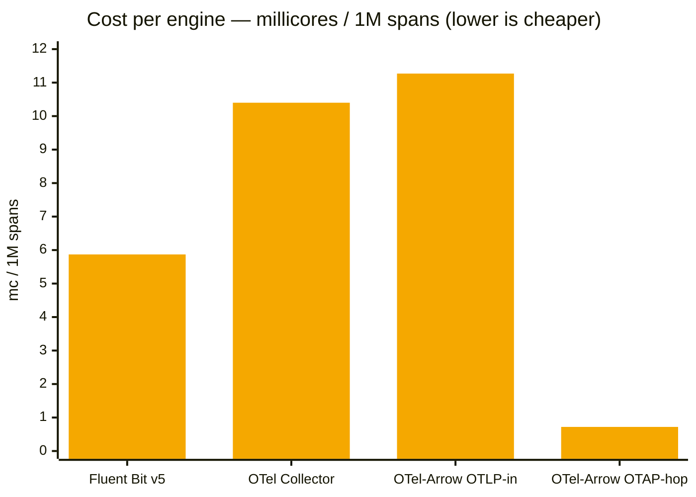
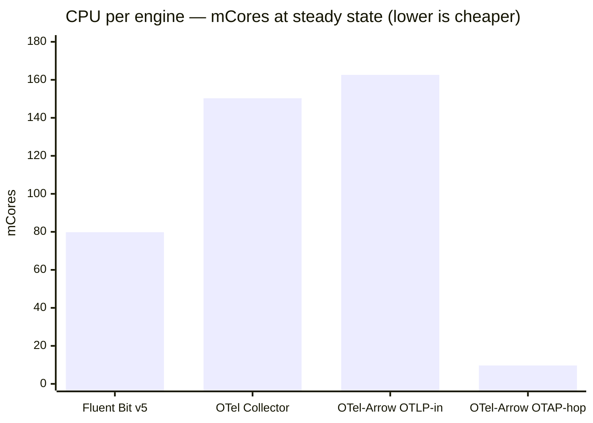
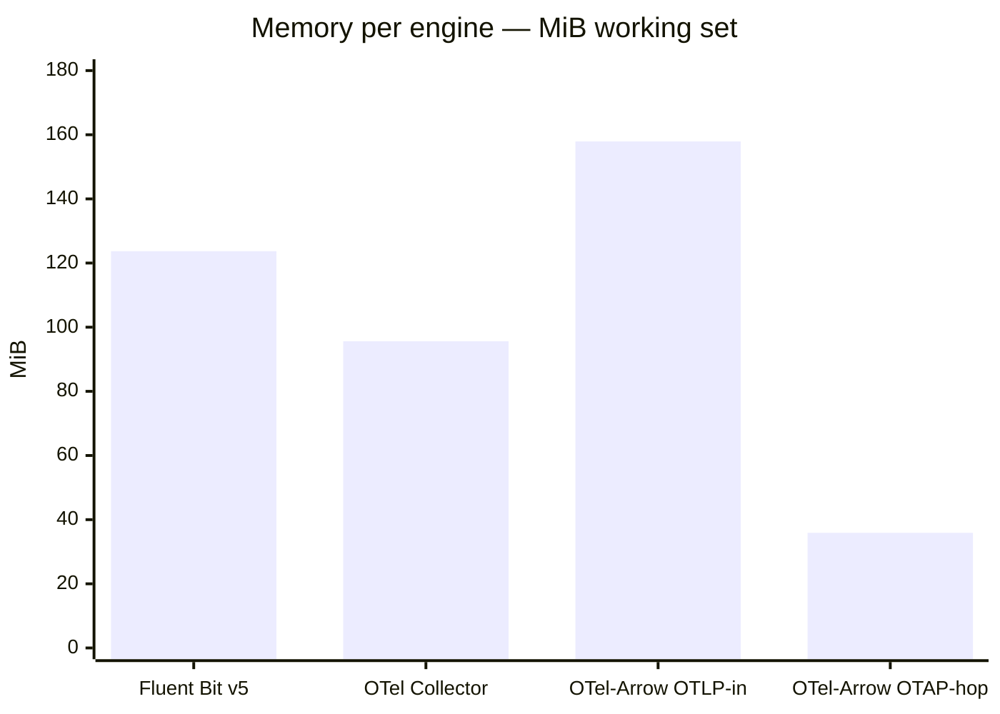
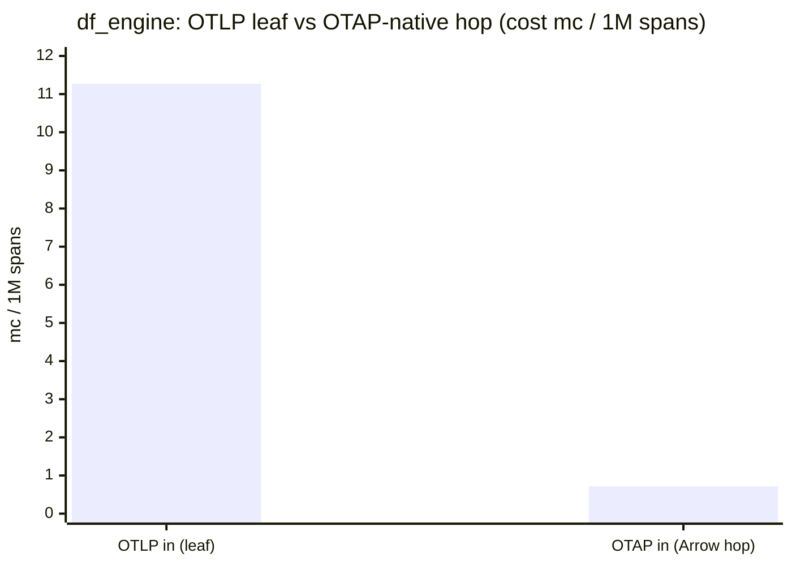
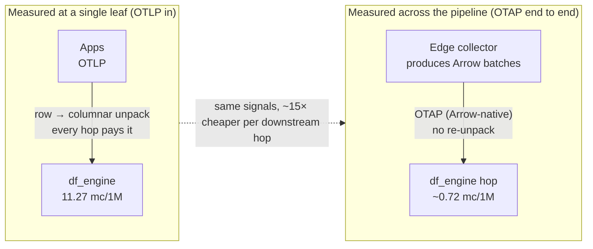
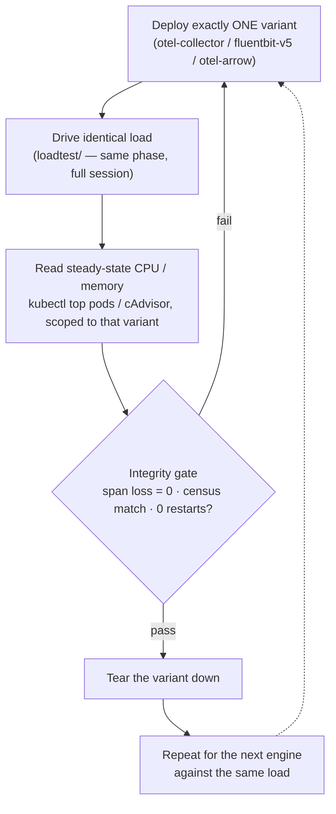

# Benchmark results — three engines, head to head

> The numbers from our own runs of the [small benchmark](./README.md): the **same
> telemetry** (traces, metrics, logs from the OTel Demo **and** hipster-shop), the
> **same feature set** (receive → parse → light-transform → batch → forward, **no tail
> sampling** in any variant), with **one engine deployed at a time** so every figure is
> attributable to a single engine.
>
> There are **two complementary readings** below, because they answer different questions:
>
> 1. **Latest validated run — 12-hour production soak.** Each engine ships the real
>    telemetry all the way to **Dynatrace** (OTLP/HTTP) under a full ramp-up + 12 h soak.
>    This is the *endurance & integrity* axis: does the engine survive a day of sustained
>    mesh traffic with no leak, no restart, and no data loss?
> 2. **Isolated leaf-cost micro-benchmark.** Each engine exports to a `nop`-style sink so
>    we measure **CPU / memory per 1M spans** with no backend variability. This is the
>    *cost* axis, run at equal load — the apples-to-apples price per span.

---

## 1. Latest validated run — 12-hour soak to Dynatrace

**Engine versions under test**

| Variant | Engine | Version / image |
|---------|--------|-----------------|
| **A — Fluent Bit v5** | Fluent Bit | `fluent/fluent-bit:5.1.5` |
| **B — OTel Collector** (reference) | collector-contrib | `otel/opentelemetry-collector-contrib:0.163.1` |
| **A′ — OTel-Arrow native** | `df_engine` / otap-dataflow | `ghcr.io/henrikrexed/df-engine:0.61.0` (Rust v0.61.0), OTLP in/out |

**Environment:** Kubernetes 1.35.3 (1 control-plane + 3×16 GiB workers), Istio 1.29.2
**ambient** mesh with an L7 **waypoint** on the export hop, Cilium CNI. Load: Locust
driving the OTel Demo (Astronomy Shop) + hipster-shop through a 50→200 VU ramp-up
staircase, then a steady 12 h soak.

### Integrity & stability gate (all PASS)

| | Fluent Bit v5 | OTel Collector | OTel-Arrow `df_engine` (OTLP) |
|---|:---:|:---:|:---:|
| **Soak duration** | 12 h | 12 h | 12 h |
| **Records / spans in** | 48.87 M records | 256.63 M spans · 191.59 M logs | 148.56 M spans · 67.76 M logs |
| **Exported to Dynatrace** | 48.87 M records | 144.0 M spans · 92.6 M logs | 137.8 M spans · 67.5 M logs |
| **Drop rate** | **0.0044 %** ✅ | refused **0**, send_failed **0** ✅ | **0.0022 %** spans · **0.0097 %** logs ✅ |
| **Engine restarts** | **0** (gateway + 3 agents) ✅ | **0** (gateway + 3 agents) ✅ | **0** (df_engine + forwarder + 3 agents) ✅ |
| **SIGSEGV / hot-reload / storage backlog** | **0 / 0 / 0** ✅ | n/a ✅ | **0 / 0 / 0** ✅ |
| **Working-set memory (engine)** | **38 MiB** | stable, 0 queue growth | stable, 0 queue growth |

**Reading it honestly.** This axis does **not** rank the engines by cost — the per-engine
absolute volumes differ (Fluent Bit counts *records*, the collector counts *spans* and
*logs* separately, and the load phase held at different VU levels per arm), so the columns
are **not** a like-for-like throughput race. What it proves is the thing a 2-hour run
cannot: **all three engines survived a full 12-hour soak of real mesh traffic with a drop
rate far below the 1 % gate and zero restarts.** In particular the Fluent Bit v5 arm
cleared the long-standing mesh-transport soak hazard (the `v5.0.x` SIGSEGV over Istio
HTTP/2) across a full 12 h window on `5.1.5`.

> The fourth configuration — df_engine receiving an **Arrow-native (OTAP) stream** instead
> of OTLP — is a separate arm; its 12 h soak is not folded into this table yet. The
> order-of-magnitude OTAP-hop effect is captured in the isolated leaf-cost reading below.

---

## 2. Isolated leaf-cost micro-benchmark (nop-sink, equal load)

> Earlier equal-load run with each engine exporting to a `nop`-style sink, so the CPU and
> memory are the **engine's own cost** with no backend in the path. Cost is normalised as
> **millicores per 1,000,000 spans** (`mc/1M spans`) so the engines are comparable
> regardless of how many spans each carried. All variants passed the same data-integrity
> gate: **span loss = 0**, census match, **0 restarts**. These figures predate the 12 h
> soak campaign above and are retained as the apples-to-apples *cost* comparison.

### KPI tiles — at a glance

| | Fluent Bit v5 | OTel Collector | OTel-Arrow `df_engine` (OTLP in) | OTel-Arrow `df_engine` (**OTAP hop**) |
|---|:---:|:---:|:---:|:---:|
| **Cost** `mc / 1M spans` | **5.87** 🟢 | 10.40 | 11.27 | **~0.72** 🏆 |
| **CPU** `mCores` | 79.8 | 150.3 | 162.6 | **9.66** |
| **Memory** | 123.7 MiB | 95.6 MiB | 157.9 MiB | **35.9 MiB** |
| **Spans processed** | 13.58 M | 14.45 M | 14.43 M | — |
| **Span loss** | 0 ✅ | 0 ✅ | 0 ✅ | 0 ✅ |
| **Restarts** | 0 ✅ | 0 ✅ | 0 ✅ | 0 ✅ |
| **Language / model** | C, native | Go, OTLP in-mem | Rust, Arrow-first | Rust, Arrow-native |

### Cost per engine — `mc / 1M spans` (lower is cheaper)

**Read it honestly:** when every engine ingests **OTLP** and does the same light
transform, Fluent Bit v5 is the cheapest per span, the Go collector sits in the middle,
and the native Arrow engine costs a little more per span **at the leaf**. That is
expected — the win of OTel-Arrow is **not** cheaper OTLP ingest; it is the
**Arrow-native hop between engines** (last bar, and the section below).

### CPU and memory — the compute you actually pay

CPU and memory are shown **next to** the per-span cost, never hidden behind the bandwidth
story. At the OTLP leaf the Arrow engine is the most expensive on both axes — the honest
price of unpacking rows into Arrow columns at every hop.

### Where OTAP actually pays off — the Arrow-native hop

The interesting result is what happens when the engine receives an **already-Arrow
(OTAP)** stream instead of OTLP, so it never pays the row→columnar unpack at ingest. In
that configuration the `df_engine`'s own footprint collapses — an order-of-magnitude drop
on every axis:

| Configuration | df_engine CPU | df_engine Memory | **Cost (mc / 1M spans)** |
|---------------|--------------:|-----------------:|-------------------------:|
| OTLP in (leaf) | 162.6 mCores | 157.9 MiB | 11.27 |
| **OTAP in (Arrow-native hop)** | **9.66 mCores** | **35.9 MiB** | **~0.72** |

The receive/parse cost does not vanish — it **shifts to the edge** that produced the Arrow
batches. Where does the efficiency live? Speak OTAP **end to end** and every downstream
hop drops by an order of magnitude:

Measured at a single leaf, OTAP looks slightly more expensive; measured across the
**pipeline**, the columnar representation is where the efficiency lives.

---

## Number discipline (repeat the baseline every time)

- OTAP efficiency is **relative to a named baseline**: **~2× vs OTLP+zstd** (typical), up
  to **~8×** on multivariate metrics, **15–30× only vs *uncompressed* OTLP**. The famous
  **"10×"** is the vs-uncompressed headline — **never quote it bare**.
- The **CPU/memory cost is real** — every bandwidth saving is shown next to the compute it
  costs. The leaf tiles and bars above are exactly that: the honest per-engine price.

---

## How these were produced

1. Deploy exactly one variant (`benchmark/otel-collector/`, `benchmark/fluentbit-v5/`,
   or `benchmark/otel-arrow/`).
2. Drive the identical load (`benchmark/loadtest/`) for the full session — pick the phase
   (`stable30` / `rampup2h` / `leak24h`) described in [`README.md`](./README.md).
3. Read steady-state CPU/memory from `kubectl top pods` (metrics-server) / cAdvisor,
   scoped to that variant's agent + gateway pods only. For the production-soak reading,
   confirm the Dynatrace-side receipt as well.
4. Confirm the integrity gate (drop < 1 %, 0 restarts, refused/send_failed = 0), tear the
   variant down, and repeat for the next engine against the same load.

> Your absolute numbers will differ with node size and load; the **ordering** in the
> leaf-cost reading, the **order-of-magnitude OTAP-hop effect**, and the **clean 12 h
> soak** are what reproduce. Re-run each variant back to back on the same cluster and
> compare *relative* cost, never a single cross-run figure.
